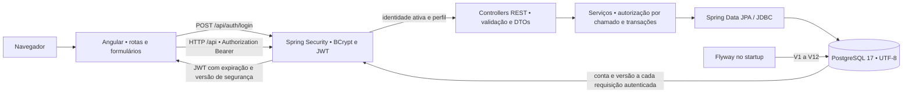

# Arquitetura do ResolveAí

No desenvolvimento, o navegador carrega o Angular na porta 4200 e acessa a API na 8080 com CORS explícito. O build de produção usa a rota relativa `/api`. A demonstração serve esse build e encaminha as chamadas no mesmo endereço de origem. O Compose da raiz inicia o banco. O processamento de chamados, as consultas de dashboard e a administração vivem na mesma aplicação Spring Boot.

A sessão da aba guarda o token. O filtro confere assinatura, emissor, validade, perfil e `versao_seguranca` da conta antes dos controllers. O serviço valida o escopo do chamado e as transições. A API devolve DTOs e registra as mudanças de estado com seus eventos na mesma transação.

## Responsabilidades

- O Angular apresenta o estado da aplicação e consome contratos tipados.
- O Spring Boot expõe os contratos REST, valida entradas e concentra regras de negócio.
- O PostgreSQL assegura integridade relacional.
- O Flyway é a fonte versionada de evolução do schema.

## Decisões de implementação

- APIs funcionais são publicadas sob `/api`.
- Configuração específica do ambiente é externa ao artefato.
- Datas da API usam ISO 8601 em UTC.
- Erros seguem um único envelope, sem stack trace ou detalhes SQL.
- A autenticação é stateless: senhas usam BCrypt e tokens JWT têm assinatura, emissor e expiração validados.
- O perfil melhora a navegação no Angular, mas toda autorização é aplicada novamente pelo Spring Security.
- O usuário autenticado é recarregado do banco em cada requisição, impedindo que contas inativas continuem usando um token emitido anteriormente.
- O Hibernate usa `ddl-auto=validate`, nunca cria ou altera tabelas e valida os mapeamentos de `Usuario`, `Categoria` e `Chamado` contra o schema criado pelo Flyway.
- A migration inicial prepara as entidades centrais do domínio sem inserir usuários ou credenciais.
- A abertura de chamado é transacional: a API recarrega o solicitante ativo, bloqueia a categoria ativa para leitura durante a criação e persiste o chamado antes de produzir o DTO.
- Protocolos usam 128 bits gerados por `SecureRandom`; a constraint única do PostgreSQL é a barreira final e colisões são repetidas em transações independentes e limitadas.
- Somente o perfil `dev` carrega categorias fictícias reproduzíveis por uma migration em `db/devdata`; produção executa apenas `db/migration`.
- As consultas do solicitante são escopadas pelo identificador autenticado já no repositório. Um detalhe inexistente e um detalhe pertencente a terceiros produzem a mesma resposta `404`, evitando confirmar a existência de dados alheios.
- As listagens AC3 aplicam busca e filtros combinados no banco, paginação padrão de 20 registros e ordenação com desempate por ID. V7 e V8 acrescentam índices de paginação e ordenação global; a URL preserva os parâmetros.
- A V9 preserva os históricos AC2 e protege as duas tabelas contra UPDATE/DELETE/TRUNCATE no PostgreSQL. Criação, status, prioridade e atribuição são consultados em uma timeline autorizada; alteração e evento são persistidos na mesma transação.
- A área de atendimento da AC2 autoriza `ATENDENTE` e `ADMIN`. A fila consulta apenas chamados `ABERTO` sem responsável; a carteira é escopada pelo usuário autenticado. As duas consultas aplicam filtros, limite e paginação no banco, com ordenação estável por criação e ID.
- Assumir um chamado altera responsável, status e data de atribuição de forma transacional, protegida pela versão do registro. Uma disputa produz uma atribuição e um conflito `409`, preservando o vencedor. O histórico de atribuição é gravado na mesma transação.
- A máquina de estados do back-end centraliza as transições, inclusive a atribuição. Cada alteração de status grava um evento em `historico_status` na mesma transação; prioridade usa o histórico de eventos de `historico_chamados`. Chamados fechados são terminais.
- O detalhe da AC2 autoriza proprietário, responsável ou ADMIN, retornando DTOs de histórico e as ações permitidas. A interface usa essas ações, mas cada mutação revalida identidade, propriedade, estado e versão no servidor.
- Os comentários reutilizam a participação do chamado, com autor definido pela autenticação e conteúdo imutável. O envio bloqueia a linha do chamado para serializar a validação com o fechamento; não muda status nem versão. A conversa tem ordem estável por data e ID e é somente leitura após o fechamento.
